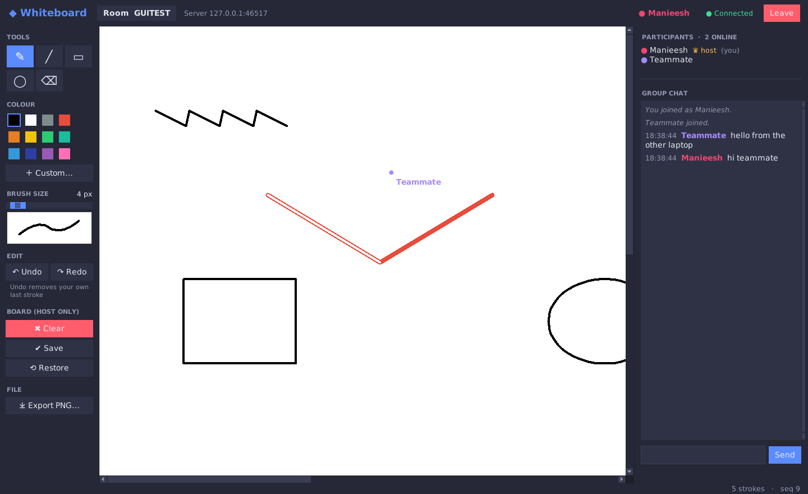

# Client — LAN Collaborative Whiteboard

Tkinter desktop client: 2,066 lines across 12 files, about a third of them comments and docstrings. Standard library only (Pillow is optional, for PNG export).
Verify with `python3 tests/client_gui_test.py` → `ALL CLIENT GUI CHECKS PASSED (33)`.



## 1. Files

| File | Lines | Responsibility |
|---|---|---|
| `client/main.py` | 34 | Entry point; command-line pre-fill |
| `client/app.py` | 552 | Controller: screens, event pump, sequence/ordering rules, recovery, hosting, shortcuts |
| `client/network.py` | 221 | Socket threads: connect + join handshake, reader, writer, heartbeat, auto-reconnect |
| `client/protocol.py` | 95 | Newline-delimited JSON framing (`LineDecoder`) and message builders |
| `client/canvas_view.py` | 443 | Drawing surface: tools, optimistic drawing, diff redraw, remote cursors/previews, export |
| `client/geometry.py` | 136 | Pure functions: RDP simplification, shapes, validation, user colours, stroke ids |
| `client/toolbar.py` | 154 | Tools, palette, custom colour, brush size, undo/redo, host actions, export |
| `client/side_panel.py` | 156 | Participant list and group chat |
| `client/connect_screen.py` | 133 | Join / host form with validation and remembered settings |
| `client/widgets.py`, `config.py` | 141 | Themed button with tooltip; every constant and the colour theme |

## 2. Requirements → implementation

| Requirement (from the project brief) | Where / how |
|---|---|
| Freehand drawing, erasing, colour selection | Pen, Eraser, 12-colour palette + custom picker, 1–50 px brush (`toolbar.py`, `canvas_view.py`) |
| Real-time synchronisation, minimal delay | Strokes are sent on mouse release; **live previews** of in-progress strokes stream at 25 Hz, so others watch you draw; `TCP_NODELAY` |
| Consistent shared canvas | Server order is authoritative; every `canvas_state` is applied as a diff to exactly the server's list |
| Clear / save / restore (with permissions) | Host-only buttons (disabled for others; server enforces it too), confirmation dialogs |
| Host a session; join by LAN address + room code | Connection screen: **Join session** or **Host new session** (runs the server in-app, generates a room code, shows the LAN address to share) |
| Participant list, join/leave notifications | Right panel with host crown and "(you)"; grey system lines in chat |
| Visually distinguish users | Each user has a fixed colour (hash of the name) used for their **live cursor with name tag**, list dot and chat name; hovering a stroke shows "Stroke by &lt;name&gt;" in the status bar |
| Newly joined users get the current board | `welcome` + `canvas_state` snapshot + replayed chat history |
| Ordering and reliability: delayed, duplicated, missing updates | Sequence numbers: older or equal = ignored, a gap = `sync` request and a fresh snapshot; stroke ids make drawing idempotent on client and server |
| Connection management, timeouts, reconnection | Heartbeat every 5 s; no data for 15 s = dead; automatic reconnect with back-off; status pill (Connected / Reconnecting / Offline) |
| Chat with sender and timestamp, chronological | Chat panel; history shown above an "earlier messages" divider; replays after a reconnect are de-duplicated |
| Recovery after disconnection | Board rebuilt from the snapshot; strokes drawn **while offline** are kept and synced automatically |
| Undo / redo with defined multi-user behaviour | Per-user (default): undo removes **your own** last stroke; the toolbar says which mode the server uses |
| Extra features | Line / rectangle / ellipse (Shift = 45° / square / circle), PNG/PostScript export, keyboard shortcuts, password-protected rooms, in-app hosting, offline drawing |

## 3. Architecture

```
            ┌──────────────── Tk main thread ────────────────┐
 mouse ───▶ │ WhiteboardCanvas ─on_stroke─▶ WhiteboardApp     │
            │      ▲  apply_state / add_stroke       │ send() │
            │      └──────────── _pump() ◀── events  ▼        │
            └──────────────────────────── queue ── outbox ───┘
                                             ▲        │
                         reader thread ──────┘        └────── writer thread
                         (recv, LineDecoder,                 (sendall, in order)
                          heartbeat, reconnect)
                                     ▲  TCP  ▼
                                   server :5000
```

* **Only the Tk thread touches widgets.** The network threads communicate through `queue.Queue`; `_pump()` drains it every 15 ms with `root.after()`, at most 400 events per tick, so a burst never freezes the UI.
* **The writer thread** means a slow network never blocks drawing.
* **Optimistic drawing:** your stroke appears instantly as 2-point segments (O(1) per mouse move). On release it is simplified, sent, and kept as *pending* until the server's `stroke_added` echo replaces it with the canonical copy. A pending stroke the server never confirms is removed after 10 s, so the screen never shows anything the server rejected.
* **Diff rendering:** `apply_state()` deletes only the strokes that disappeared, creates only the new ones, and restacks only if the order changed.

Measured on a 3,000-stroke board (Python 3.12, Tk 8.6):

| Operation | Time |
|---|---|
| Initial snapshot (join) | 117 ms |
| Undo (diff, 1 stroke removed) | 8 ms |
| Redo (diff, 1 stroke appended) | 8 ms |
| 200 live `stroke_added` | 26 ms total |

**Network traffic savings:** mouse samples closer than 1.5 px are skipped, and Ramer–Douglas–Peucker simplification (0.6 px tolerance) removes 50–80 % of points with no visible change. Coordinates are rounded to 0.1 px, JSON is sent with compact separators, cursor updates are batched to 25/s, and a shape is sent as only 2–65 points.

## 4. Application protocol (complete)

Transport: **TCP**, chosen for reliable, ordered delivery, so no stroke is lost or reordered within a connection. Framing: **one JSON object per line** (`\n`-terminated, UTF-8). The receiver buffers bytes and parses only complete lines. Server limit 512 KB per message, client limit 8 MB (a full `canvas_state` can be large).

**Client → server**

| type | fields | notes |
|---|---|---|
| `join` | `username`, `room_code`, `password` | must be the first message |
| `draw` / `erase` | `stroke{stroke_id, color, width, points}` | server adds `tool`, `username`; duplicate id → `stroke_duplicate` |
| `chat` | `message` | ≤ 500 chars |
| `undo` / `redo` | — | per-user by default |
| `clear` / `save` / `load` | — | host only |
| `cursor` | `x`,`y` or `hidden`, optional `preview{stroke_id,color,width,tool,points,replace}` or `{stroke_id,cancel}` | transient, ≤ 50/s |
| `sync` | — | asks for a fresh snapshot |
| `ping` | — | heartbeat; answered with `pong` |

**Server → client**

| type | sequenced | fields |
|---|---|---|
| `welcome` | yes | `username`, `participants`, `host`, `room_code`, `undo_mode` |
| `canvas_state` | yes | `strokes`, optional `action` (undo/redo/clear/load/sync), `by` |
| `stroke_added` | yes | `stroke` |
| `user_joined` / `user_left` | yes | `username`, `participants`, `host` |
| `chat` | yes | `username`, `message`, `timestamp`, `time`, optional `history` |
| `cursor` | no | `username`, `x`,`y` / `hidden`, `preview` |
| `error`, `save_success`, `load_success`, `stroke_duplicate`, `pong` | no | `message` / `stroke_id` |

**Client ordering rule** (`app.py → _check_sequence`): if `seq <= last` → ignore (duplicate or late). If `seq == last+1` → apply. If `seq > last+1` → apply, then send `sync` once; the snapshot resets `last`. TCP already guarantees order within one connection, so a gap means something went wrong above TCP, and the snapshot repairs it.

## 5. Recovery sequence

1. The connection drops (server restarted, Wi-Fi blip, cable pulled). Either `recv()` returns 0 or the 15 s silence timer fires.
2. The status pill shows **Reconnecting…**; undo, chat and host buttons are disabled. **Drawing still works**: new strokes stay *pending*.
3. The client retries after 1, 2, 3, 5, 5… s for up to 2 minutes and re-joins under the same name. If the server still holds the old session, "Username already taken" is retried rather than shown.
4. `welcome` + `canvas_state` rebuild the board. Pending strokes that are already in the snapshot are dropped; the rest are re-sent. The server ignores any it already has.

## 6. User guide

**Install (Ubuntu, once)**
```bash
sudo apt install python3-tk
cd ~/CollaborativeWhiteboard && source venv/bin/activate
pip install pillow          # optional, for PNG export
```

**Option A: host from the app (simplest)**
```bash
python3 -m client.main
```
Enter your name, keep port 5000, leave Room code empty and press **Host new session**. The top bar shows the room code and `others join at <your-LAN-IP>:5000`. Share both.

**Option B: dedicated server**
```bash
python3 -m server.server --room CN2026            # add --password secret to protect it
python3 -m client.main                             # on every machine
```
Each user enters the server's IP, port, room code (and password) and presses **Join session**.

**LAN across machines (VirtualBox):** set the VM's network adapter to **Bridged Adapter** (Settings → Network) so it gets an IP on the same LAN as the other laptops. Find it with `hostname -I`. Allow the port if a firewall is on: `sudo ufw allow 5000/tcp`. No internet connection is needed.

**Shortcuts:** `P` pen · `L` line · `R` rectangle · `O` ellipse · `E` eraser · `[` / `]` brush size · `Ctrl+Z` undo · `Ctrl+Y` / `Ctrl+Shift+Z` redo · `Ctrl+S` save (host) · hold **Shift** for a 45° line, square or circle · middle-drag or wheel to scroll (Shift+wheel = horizontal).

## 7. Tests

| Test | What it proves |
|---|---|
| `tests/backend_e2e_test.py` (20 tests) | Every server rule, using real TCP clients against a real server process |
| `tests/client_gui_test.py` (33 checks) | The real GUI driven by synthetic mouse events, with a raw-socket second user. Covers drawing, preview, shapes, eraser, chat, per-user undo, duplicate and lost updates, host permissions, export, server crash → offline drawing → auto-reconnect → sync, and in-app hosting |

```bash
python3 tests/backend_e2e_test.py
python3 tests/client_gui_test.py --screenshots    # also refreshes docs/screenshots/
```
